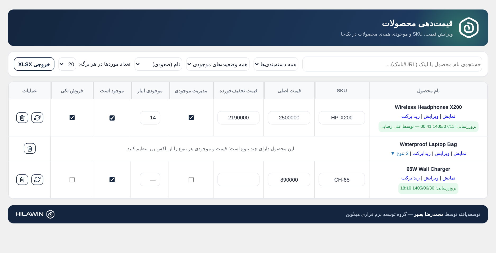
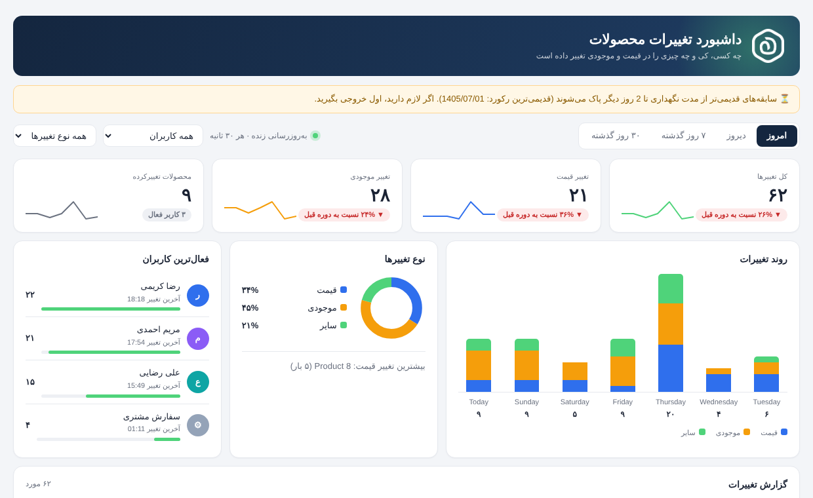

# Expert Price & Stock Manager

[فارسی](#فارسی) · [English](#english)

---

## فارسی

افزونه ووکامرس برای **مدیریت یک‌جای قیمت، SKU و موجودی همه محصولات و تنوع‌ها** در یک جدول، همراه با خروجی اکسل و داشبورد پیگیری تغییرات.
توسعه‌یافته توسط **محمدرضا بصیر** — گروه توسعه نرم‌افزاری هیلاوین.

### امکانات

- ویرایش درجا: SKU، قیمت اصلی، قیمت حراج، مدیریت موجودی، تعداد موجودی، وضعیت موجود/ناموجود و «فروش تکی»
- ردیف تنوع‌ها با لینک «نمایش» و «ویرایش» برای هر تنوع
- جستجو با نام یا آدرس (URL/نامک)، فیلتر دسته‌بندی، برند و وضعیت موجودی، مرتب‌سازی بر اساس نام و قیمت
- انتخاب تعداد موردها در هر برگه (پیش‌فرض ۲۰) و ستون‌های قابل تغییر اندازه (ذخیره در مرورگر)
- نمایش «بروزرسانی: تاریخ شمسی — توسط کاربر» برای هر محصول؛ تغییرات ناشی از سفارش‌ها هم ثبت می‌شود
- همگام‌سازی فیلدهای «آخرین بروزرسانی» قالب (`_show_last_modified` / `_custom_last_modified`) با تاریخ شمسی
- خروجی XLSX با انتخاب ستون‌ها، ترتیب‌دهی و ذخیره قالب
- حذف محصول با گزینه ساخت ریدایرکت در Rank Math
- بارگذاری تنبل (lazy)، انیمیشن لود و کم‌حجم بودن روی سایت

### داشبورد تغییرات

- چه کسی و چه زمانی قیمت یا موجودی را عوض کرده: امروز، دیروز، ۷ روز و ۳۰ روز گذشته
- نمودار روند، سهم هر نوع تغییر، فعال‌ترین کاربران، جدول گزارش و بازگرداندن (Revert) تغییرهای دستی
- سابقه فقط **۳۲ روز** نگه داشته می‌شود و خودکار پاک می‌شود؛ از روز ۳۰ هشدار «x روز دیگر پاک می‌شود» نمایش داده می‌شود

### نیازمندی‌ها و نصب

وردپرس ۶ به بالا، ووکامرس و PHP 7.4 به بالا. پوشه افزونه را با نام `expert-price-manager` زیپ کنید و از «افزونه‌ها ← افزودن ← بارگذاری» نصب کنید، یا آن را در `wp-content/plugins/` کپی کنید. منو با نام **«مدیریت قیمت»** در پیشخوان و نوار بالا ظاهر می‌شود. دسترسی فقط برای نقش‌هایی است که `manage_woocommerce` دارند.

ترجمه فارسی (`fa_IR`) همراه افزونه است. تغییرات نسخه‌ها در [`readme.txt`](readme.txt).

---

## English

A WooCommerce plugin to **edit prices, SKU and stock of all products and variations in one table**, with XLSX export and a changes dashboard.
Developed by **Mohammadreza Basir** — Hilawin Software Development Group.

### Features

- Inline editing: SKU, regular/sale price, manage stock, quantity, in/out of stock and "sold individually"
- Variation rows with View / Edit links for each variation
- Search by name or URL/slug, category / brand / stock-status filters, sorting by name and price
- Items-per-page selector (default 20) and resizable columns (saved in the browser)
- "Updated: Jalali date — by user" line per product; stock changes made by orders are tracked too
- Keeps the theme's "last modified" fields (`_show_last_modified` / `_custom_last_modified`) in sync with a Jalali date
- XLSX export with column picker, ordering and saved templates
- Product delete flow with an optional Rank Math redirect
- Lazy-loaded code, loading animation, lightweight on the front end

### Changes dashboard

- Who changed prices or stock and when: today, yesterday, last 7 / 30 days
- Trend chart, change-type breakdown, most active users, report table and one-click revert for manual changes
- Logs are kept for **32 days only** and purged automatically; a notice appears from day 30 ("x days left")

### Requirements & install

WordPress 6+, WooCommerce, PHP 7.4+. Zip the folder as `expert-price-manager/` and upload it via Plugins → Add New → Upload, or copy it to `wp-content/plugins/`. The **Price Manager** menu appears in the admin menu and toolbar; access requires the `manage_woocommerce` capability.

A Persian (`fa_IR`) translation is bundled. See [`readme.txt`](readme.txt) for the changelog.

## License

GPLv2 or later.
