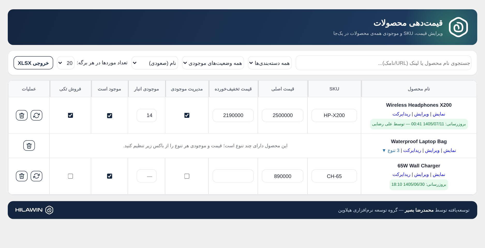
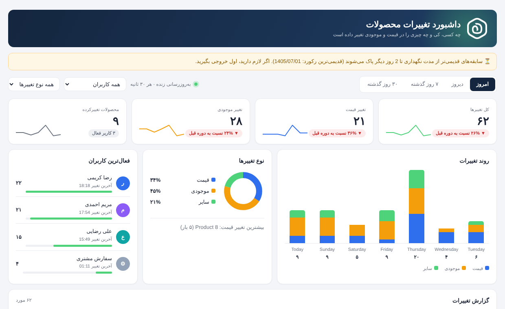

# Expert Price & Stock Manager

[فارسی](#فارسی) · [English](#english)



> نسخه: **1.1.14** · وردپرس ۶+ · ووکامرس ۷+ · PHP 7.4+ · لایسنس GPLv2 یا بالاتر
> Version **1.1.14** · WordPress 6+ · WooCommerce 7+ · PHP 7.4+ · GPLv2 or later

---

## فارسی

**Expert Price & Stock Manager** یک افزونه ووکامرس برای **مدیریت سریع و یک‌جای قیمت، SKU و موجودی همه محصولات و تنوع‌ها** در یک جدول است. هر تغییر ثبت می‌شود و در یک داشبورد قابل پیگیری است. افزونه برای فروشگاه‌های فارسی‌زبان (RTL، تاریخ شمسی، ترجمه کامل) ساخته شده است.

توسعه‌یافته توسط **محمدرضا بصیر** — گروه توسعه نرم‌افزاری هیلاوین.

### فهرست

1. [امکانات](#امکانات)
2. [نصب و راه‌اندازی](#نصب-و-راهاندازی)
3. [راهنمای استفاده](#راهنمای-استفاده)
4. [داشبورد تغییرات](#داشبورد-تغییرات)
5. [خروجی XLSX](#خروجی-xlsx)
6. [حذف محصول و ریدایرکت Rank Math](#حذف-محصول-و-ریدایرکت-rank-math)
7. [دسترسی‌ها و امنیت](#دسترسیها-و-امنیت)
8. [داده‌ها و حذف افزونه](#دادهها-و-حذف-افزونه)
9. [عملکرد و بهینه‌سازی](#عملکرد-و-بهینهسازی)
10. [نکات فنی برای توسعه‌دهندگان](#نکات-فنی-برای-توسعهدهندگان)
11. [عیب‌یابی](#عیبیابی)
12. [تاریخچه نسخه‌ها](#تاریخچه-نسخهها)

### امکانات

**ویرایش جدولی**
- ویرایش درجا و بدون بارگذاری مجدد صفحه: SKU، قیمت اصلی، قیمت حراج، «مدیریت موجودی»، تعداد موجودی، وضعیت موجود/ناموجود و «فروش تکی»
- ردیف جدا برای هر تنوع محصول متغیر، با لینک «نمایش» (صفحه خود تنوع) و «ویرایش» (صفحه محصول مادر)
- قانون هوشمند موجودی: با برداشتن تیک «موجود است»، موجودی صفر و قفل می‌شود؛ با زدن دوباره تیک، اگر موجودی صفر بود، ۱ می‌شود. این قانون در سرور هم اعمال می‌شود
- «فروش تکی»: خریدار فقط می‌تواند ۱ عدد از آن محصول در هر سفارش بخرد. اگر تیک نداشته باشد، تا سقف موجودی انبار قابل سفارش است
- نمایش «بروزرسانی: تاریخ شمسی — توسط کاربر» زیر هر محصول. تغییرهای ناشی از سفارش‌ها (کاهش موجودی در checkout) با برچسب «سفارش» ثبت می‌شوند
- بروزرسانی خودکار جدول هر ۲۰ ثانیه (فقط وقتی تب فعال است) تا تغییرهای دیگران را ببینید

**جستجو، فیلتر و مرتب‌سازی**
- جستجو با نام محصول، SKU یا **آدرس (URL/نامک)** محصول
- فیلتر دسته‌بندی، برند (در صورت وجود taxonomy برند) و وضعیت موجودی (همه / موجود / ناموجود، پیش‌فرض: همه)
- مرتب‌سازی بر اساس نام و قیمت
- انتخاب تعداد موردها در هر برگه: ۱۰، ۲۰ (پیش‌فرض)، ۵۰، ۱۰۰ یا ۲۰۰، ذخیره‌شده در مرورگر
- ستون‌های قابل تغییر اندازه با ماوس؛ عرض‌ها بعد از رفرش حفظ می‌شود (سازگار با RTL)

**ظاهر**
- طراحی یکپارچه برند هیلاوین، بنر بالا، فوتر و آیکن اختصاصی منو
- انیمیشن لود (نوار پیشرفت، ردیف‌های placeholder، اسپینر تنوع‌ها). با «کاهش حرکت» سیستم‌عامل خاموش می‌شود
- میانبر سریع در **نوار ابزار بالای وردپرس** (admin bar) و منوی پیشخوان (موقعیت ۳)
- پنهان‌سازی اعلان‌ها و تبلیغات سایر افزونه‌ها داخل صفحه‌های افزونه

**گزارش و خروجی**
- [داشبورد تغییرات](#داشبورد-تغییرات) با نمودار، آمار، لیست کاربران و بازگردانی تغییرها
- [خروجی XLSX](#خروجی-xlsx) سفارشی با ستون‌های انتخابی و قالب‌های ذخیره‌شونده
- [حذف محصول](#حذف-محصول-و-ریدایرکت-rank-math) با ریدایرکت Rank Math

**یکپارچگی با قالب و سئو**
- همگام‌سازی فیلدهای «آخرین بروزرسانی» قالب (`_show_last_modified` و `_custom_last_modified`) با **تاریخ شمسی** (`Y/m/d`)، فقط اگر قالب سایت از این فیلدها استفاده کند
- ستون‌های سئوی Rank Math در خروجی XLSX

### نصب و راه‌اندازی

**پیش‌نیازها:** وردپرس ۶ به بالا، ووکامرس (فعال)، PHP 7.4 به بالا.

**نصب از طریق پیشخوان**
1. پوشه افزونه را با نام `expert-price-manager` زیپ کنید (فایل `expert-price-manager.php` باید داخل همین پوشه باشد).
2. پیشخوان ← **افزونه‌ها ← افزودن ← بارگذاری افزونه**، فایل zip را انتخاب و نصب کنید.
3. اگر نسخه قبلی نصب است، فوراً روی «Replace current with uploaded» بزنید (تأخیر خطای nonce می‌دهد).
4. افزونه را **فعال** کنید. منوی **«مدیریت قیمت»** در پیشخوان و نوار بالا ظاهر می‌شود.

**نصب از گیت**
```bash
cd wp-content/plugins
git clone https://github.com/rzabasir/expert-price.git expert-price-manager
```
پوشه را حتماً با نام `expert-price-manager` کلون کنید تا مسیر افزونه با نسخه‌های قبلی یکی بماند.

> دکمه «Download ZIP» گیت‌هاب پوشه‌ای به نام `expert-price-main` می‌سازد. قبل از آپلود نام پوشه را به `expert-price-manager` تغییر دهید.

**بعد از نصب:** در فعال‌سازی، جدول تاریخچه تغییرات ساخته و یک زمان‌بندی روزانه برای پاک‌سازی ثبت می‌شود. تنظیمات اضافه‌ای لازم نیست.

### راهنمای استفاده

1. از منوی **مدیریت قیمت ← قیمت‌دهی محصولات** وارد شوید.
2. محصول را جستجو یا فیلتر کنید.
3. قیمت، SKU، موجودی یا تیک‌ها را عوض کنید و روی دکمه **بروزرسانی** (آیکن چرخان) ردیف بزنید. نتیجه فوراً ذخیره و در «بروزرسانی: …» نمایش داده می‌شود.
4. برای محصول متغیر، روی «n تنوع ▼» بزنید تا ردیف تنوع‌ها باز شود. هر تنوع قیمت و موجودی مستقل دارد.
5. با دکمه **سطل زباله** محصول را حذف کنید ([جزئیات](#حذف-محصول-و-ریدایرکت-rank-math)).

| فیلد | توضیح |
|---|---|
| SKU | شناسه کالا؛ تکراری بودن را ووکامرس بررسی می‌کند |
| قیمت اصلی / تخفیف‌خورده | اعداد ساده؛ قیمت تخفیف‌خورده باید کمتر از قیمت اصلی باشد |
| مدیریت موجودی | روشن: تعداد دقیق ردیابی می‌شود؛ خاموش: فقط موجود/ناموجود |
| موجودی انبار | تعداد؛ فقط با «مدیریت موجودی» فعال می‌شود |
| موجود است | وضعیت انبار؛ با موجودی ۰ ناموجود می‌شود |
| فروش تکی | حداکثر ۱ عدد در هر سفارش |

### داشبورد تغییرات



منوی **مدیریت قیمت ← داشبورد تغییرات**. نشان می‌دهد چه کسی، چه زمانی و چه چیزی را عوض کرده است.

- **بازه‌ها:** امروز، دیروز، ۷ روز و ۳۰ روز گذشته (بر اساس منطقه زمانی سایت)
- **آمار کلی:** کل تغییرها، تغییر قیمت، تغییر موجودی، تعداد محصولات تغییرکرده و مقایسه با دوره قبل، با نمودار کوچک
- **نمودارها:** روند روزانه (قیمت / موجودی / سایر)، سهم هر نوع تغییر، فعال‌ترین کاربران و پرتغییرترین محصول
- **فیلتر:** بر اساس کاربر و نوع تغییر؛ بروزرسانی زنده هر ۳۰ ثانیه
- **جدول گزارش:** مقدار قدیم و جدید، محصول، SKU، کاربر، منبع تغییر، با صفحه‌بندی ۱۵تایی
- **بازگردانی (Revert):** برگرداندن تغییرهای دستی کاربر به مقدار قبلی. اگر مقدار فعلی محصول با مقدار ثبت‌شده فرق کند (یعنی بعداً دوباره عوض شده)، بازگردانی رد می‌شود تا تغییر تازه‌تر پاک نشود
- **نگهداری ۳۲ روزه:** رکوردهای قدیمی‌تر از ۳۲ روز خودکار و روزانه (WP-Cron) پاک می‌شوند. از روز ۳۰ هشدار «x روز دیگر پاک می‌شود» نمایش داده می‌شود. اگر نیاز دارید، پیش از پاک شدن خروجی بگیرید

فیلدهای ثبت‌شونده: قیمت اصلی، قیمت حراج، مدیریت موجودی، تعداد موجودی، وضعیت موجودی، SKU و فروش تکی. منبع هر تغییر یکی از `user` (کاربر)، `order` (سفارش) یا `revert` (بازگردانی) است.

### خروجی XLSX

دکمه **XLSX** بالای جدول. فایل با نویسنده داخلی (بدون نیاز به کتابخانه خارجی) ساخته می‌شود و فرایند در چند مرحله (start ← batch ← download) انجام می‌شود تا روی فروشگاه‌های بزرگ هم timeout نخورد (۱۰۰ محصول در هر مرحله).

- **ستون‌های قابل انتخاب (۳۰ ستون)** در گروه‌های:
  - پایه: ID، نام، SKU، نوع محصول، وضعیت انتشار، لینک، شناسه والد
  - قیمت: قیمت اصلی، حراج، قیمت فعلی، شروع و پایان حراج (شمسی)
  - موجودی: مدیریت موجودی، تعداد، فروش تکی، وضعیت موجودی
  - طبقه‌بندی: دسته‌ها، برندها، برچسب‌ها
  - سئو (Rank Math): عنوان، توضیح متا، کلمه کلیدی، noindex
  - سایر: تاریخ ایجاد/ویرایش (شمسی)، آخرین بروزرسانی و کاربر آن، تعداد فروش، وزن، ابعاد
- **فیلترها:** همان فیلتر وضعیت موجودی صفحه (در صورت نبود فیلتر جدا)، دسته، برند، جستجو
- **قالب‌ها:** هر کاربر تا ۳۰ قالب از ستون‌ها را ذخیره و بعداً اعمال می‌کند
- **پاک‌سازی:** فایل‌های موقت در `wp-content/uploads/epm-exports` ساخته و پس از دانلود/حذف افزونه پاک می‌شوند

### حذف محصول و ریدایرکت Rank Math

دکمه سطل زباله چهار حالت دارد:

| حالت | رفتار |
|---|---|
| انتقال به زباله‌دان | برگشت‌پذیر، بدون ریدایرکت |
| 410 | حذف دائمی؛ صفحه «برای همیشه حذف شده» (بدون مقصد) |
| 301 به دسته | حذف دائمی؛ انتقال به دسته‌بندی محصول |
| 301 به آدرس دلخواه | حذف دائمی؛ انتقال به URL دلخواه (باید معتبر و غیر از خود محصول باشد) |

حالت‌های ۴۱۰ و ۳۰۱ به ماژول **Redirections افزونه Rank Math** نیاز دارند. ترتیب کار امن است: اعتبارسنجی ← ساخت ریدایرکت ← حذف محصول. اگر حذف شکست بخورد، ریدایرکت تازه ساخته‌شده برداشته می‌شود تا محصول باقی‌مانده اشتباهاً ۴۱۰ نشود. اگر Rank Math فعال نباشد، محصول حذف نمی‌شود و پیام روشن می‌دهد.

### دسترسی‌ها و امنیت

- دسترسی فقط برای کاربرانی با قابلیت **`manage_woocommerce`** (مدیر کل و مدیر فروشگاه)
- همه درخواست‌های AJAX با nonce (`epm_admin_pricing_action`) و بررسی قابلیت محافظت شده‌اند
- خروجی‌های نمایش‌داده‌شده (نام محصول، SKU، لینک‌ها و...) قبل از درج در صفحه escape می‌شوند
- ورودی‌ها sanitize و قیمت‌ها با `wc_format_decimal` نرمال می‌شوند
- اگر پلاگین یا اسنیپت دیگری درخواست‌های AJAX افزونه را ریدایرکت کند (مثلاً به صفحه تأیید حساب)، افزونه به‌جای خطای مبهم، پیام قابل‌فهم با نام عامل ریدایرکت نشان می‌دهد
- فایل‌های موقت خروجی با توکن اختصاصی هر درخواست ساخته می‌شوند و فقط برای کاربر مجاز قابل دانلودند

### داده‌ها و حذف افزونه

- **قیمت و موجودی** مستقیم روی خود محصول ووکامرس (متای استاندارد مثل `_regular_price` و `_stock`) ذخیره می‌شوند. غیرفعال‌سازی، بروزرسانی یا حذف افزونه آن‌ها را هرگز تغییر نمی‌دهد.
- **ریدایرکت‌های Rank Math** را خود Rank Math نگه می‌دارد و با حذف افزونه باقی می‌مانند.
- **داده‌های اختصاصی افزونه:** جدول `{prefix}epm_changes` (تاریخچه)، نسخه دیتابیس `epm_db_version`، متاهای `_price_update_date`، `_epm_price_updated_by`، `_epm_update_source`، `_epm_last_stock`، قالب‌های خروجی هر کاربر (user meta با نام `epm_export_templates`) و زمان‌بندی `epm_purge_changes`.
- **حذف کامل (Delete از لیست افزونه‌ها)** فقط داده‌های اختصاصی بالا (جدول تاریخچه، قالب‌های خروجی، فایل‌های موقت، زمان‌بندی و آپشن نسخه) را پاک می‌کند. قیمت‌ها، موجودی و ریدایرکت‌ها دست‌نخورده می‌مانند.

### عملکرد و بهینه‌سازی

- **بارگذاری تنبل (lazy):** در هر درخواست فقط چند فایل کوچک لود می‌شود. صفحه‌ها فقط هنگام باز شدن، و فایل‌های AJAX فقط برای اکشن مربوطه لود می‌شوند. میانبر نوار ابزار فقط برای کاربران مجاز لود می‌شود.
- **دارایی‌ها** (CSS/JS) فقط در صفحه‌های خود افزونه صف می‌شوند. نسخه فایل‌ها با `filemtime` ساخته می‌شود تا کش مرورگر بعد از بروزرسانی خودکار تازه شود.
- **پولینگ** هر ۲۰ ثانیه، متوقف در تب‌های مخفی. تنوع‌ها فقط با باز کردن ردیف لود می‌شوند.
- **داشبورد:** آمار در یک کوئری SQL تجمیعی (با ایندکس روی `created_at`، `(user_id, created_at)` و `product_id`) محاسبه می‌شود.
- **پاک‌سازی تاریخچه** در دسته‌های ۵۰۰۰تایی انجام می‌شود تا قفل دیتابیس ایجاد نشود.
- **ثبت تغییر موجودی سفارش‌ها** حتی در checkout سمت سایت فعال است (نه فقط پیشخوان).

### نکات فنی برای توسعه‌دهندگان

**ساختار فایل‌ها**

```
expert-price-manager.php        فایل اصلی، لودر تنبل و ثابت‌ها
uninstall.php                   پاک‌سازی داده‌های اختصاصی هنگام حذف
includes/
  core.php                      دسترسی، جستجو، نسخه دارایی‌ها، همگام‌سازی فیلدهای قالب
  jalali.php                    تبدیل تاریخ میلادی ↔ شمسی
  changelog.php                 جدول تاریخچه، snapshot/diff، پاک‌سازی ۳۲ روزه، WP-Cron
  order-stock.php               ثبت تغییر موجودی ناشی از سفارش‌ها و برچسب کاربر
  admin-bar.php                 میانبر نوار ابزار و آیکن منو
  class-epm-xlsx-writer.php     نویسنده XLSX بدون وابستگی
admin/
  menu.php                      ثبت منو؛ لود تنبل صفحه‌ها
  common.php                    بنر، فوتر و پنهان‌سازی اعلان‌های دیگر افزونه‌ها
  pricing-page.php              صفحه قیمت‌دهی (جدول، خروجی، حذف)
  changes-page.php              صفحه داشبورد تغییرات
ajax/
  admin-pricing.php             لیست محصولات/تنوع‌ها، ذخیره، poll
  admin-delete.php              حذف محصول + ریدایرکت Rank Math
  admin-export.php              مراحل خروجی XLSX و قالب‌ها
  admin-changelog.php           داده‌های داشبورد و بازگردانی
assets/ (css, js, img)          استایل‌ها، اسکریپت‌ها و لوگوی برند
languages/                      .pot / fa_IR .po / .mo
docs/                           تصاویر README
```

**اکشن‌های AJAX** (همه `wp_ajax_` و نیازمند nonce `epm_admin_pricing_action`)

`epm_admin_get_products` · `epm_admin_get_variations` · `epm_admin_save_price` · `epm_admin_poll` · `epm_admin_delete_preflight` · `epm_admin_delete_product` · `epm_export_start` · `epm_export_batch` · `epm_export_download` · `epm_export_save_template` · `epm_export_delete_template` · `epm_log_dashboard` · `epm_log_revert`

لودر بر اساس پیشوند اکشن تصمیم می‌گیرد کدام فایل AJAX را لود کند (`epm_export_`، `epm_log_`، `epm_admin_delete_` یا بقیه).

**فیلترها (hooks)**

```php
// خاموش/روشن کردن همگام‌سازی فیلدهای «آخرین بروزرسانی» قالب
add_filter( 'epm_sync_theme_last_modified', '__return_false' );

// تغییر مقدار نوشته‌شده در _custom_last_modified (پیش‌فرض: تاریخ شمسی Y/m/d)
add_filter( 'epm_theme_last_modified_value', function ( $value, $product_id ) {
	return $value;
}, 10, 2 );
```

**ثابت‌ها:** `EPM_VERSION`، `EPM_PLUGIN_DIR`، `EPM_PLUGIN_URL`، `EPM_PLUGIN_FILE`، `EPM_LOG_RETENTION_DAYS` (۳۲)، `EPM_LOG_WARN_DAYS` (۳۰)، `EPM_DB_VERSION`.

**جدول `{prefix}epm_changes`:** `created_at` (INT، timestamp)، `product_id`، `parent_id`، `user_id`، `source` (`user`/`order`/`revert`)، `field`، `old_value`، `new_value`، `product_name`، `sku`. با dbDelta ساخته و با `epm_maybe_upgrade` بروزرسانی می‌شود.

**ترجمه:** متن‌های سورس انگلیسی هستند و ترجمه فارسی در `languages/` قرار دارد. رشته‌های JavaScript از طریق `wp_localize_script` ارسال می‌شوند. برای افزودن زبان، فایل `.pot` را با Poedit باز کنید و `.po/.mo` بسازید (`expert-price-manager-<locale>.mo`).

**استانداردها:** کد با WordPress Coding Standards (phpcs) بررسی شده؛ فقط هشدار «unknown capability: manage_woocommerce» باقی است که بی‌ضرر است. شبیه‌ساز تست و SQL روی MariaDB اجرا شده، اما **تست کامل روی سایت زنده با WooCommerce انجام نشده است**. قبل از استفاده روی فروشگاه اصلی، روی نسخه staging امتحان کنید.

### عیب‌یابی

| مشکل | راه‌حل |
|---|---|
| منو یا صفحه دیده نمی‌شود | ووکامرس فعال باشد و کاربر `manage_woocommerce` داشته باشد |
| خطا و ریدایرکت به صفحه‌ای دیگر هنگام بروزرسانی | یک پلاگین یا اسنیپت درخواست AJAX را ریدایرکت می‌کند. پیام افزونه نام آن را نشان می‌دهد؛ برای `admin-ajax.php` آن را مستثنی کنید |
| بعد از بروزرسانی، ظاهر قدیمی دیده می‌شود | کش مرورگر/CDN/افزونه کش را پاک کنید (نسخه فایل‌ها خودکار عوض می‌شود) |
| خطای nonce هنگام آپلود افزونه | بلافاصله پس از آپلود روی «Replace» بزنید یا از FTP جایگزین کنید |
| تاریخچه خالی است | افزونه را یک بار غیرفعال/فعال کنید تا جدول ساخته شود |
| هشدار `zlib output compression` | تنظیم سرور است، `zlib.output_compression` را Off کنید |
| دکمه حذف با ریدایرکت کار نمی‌کند | ماژول Redirections در Rank Math باید فعال باشد |

### تاریخچه نسخه‌ها

جزئیات کامل در [`readme.txt`](readme.txt). خلاصه:

- **1.1.14** دکمه‌های عملیات ۱۰٪ کوچک‌تر با فاصله
- **1.1.13** لیزلود کد، ثبت تغییر موجودی سفارش‌های سمت سایت، توقف پولینگ در تب مخفی
- **1.1.12 – 1.1.10** نمایش «توسط کاربر»، وسط‌چین شدن جدول، یک‌خطی شدن باکس بروزرسانی
- **1.1.11** انیمیشن لود
- **1.1.8** فیلتر موجود/ناموجود
- **1.1.6** انتخاب تعداد در هر برگه
- **1.1.5** لینک نمایش/ویرایش برای تنوع‌ها
- **1.1.x (قبل‌تر)** داشبورد تغییرات، نگهداری ۳۲ روزه، همگام‌سازی فیلد قالب، محافظ ریدایرکت AJAX، ستون‌های قابل تغییر اندازه، مدیریت موجودی و فروش تکی

---

## English

**Expert Price & Stock Manager** is a WooCommerce plugin for **fast, one-screen editing of prices, SKUs and stock for all products and variations** in a single table. Every change is logged and reviewable in a dashboard. It is built for Persian-language stores (RTL, Jalali dates, full translation), and works in English too.

Developed by **Mohammadreza Basir** — Hilawin Software Development Group.

### Features

**Table editing**
- Inline editing without page reloads: SKU, regular price, sale price, manage stock, quantity, in/out of stock and "sold individually"
- A row per variation of variable products, with **View** (the variation's own URL) and **Edit** (parent product edit screen) links
- Smart stock rule: unticking "in stock" zeroes and locks the quantity; re-ticking sets it to 1 if it was 0 (enforced on the server too)
- "Sold individually" limits the buyer to 1 unit per order; if unticked, buyers can order up to the available stock
- "Updated: Jalali date — by user" under each product; stock changes made by orders (checkout) are tagged as "order"
- Table auto-refreshes every 20 s (only while the tab is visible)

**Search, filter, sort**
- Search by product name, SKU or **URL/slug**
- Category, brand (when a brand taxonomy exists) and stock-status filters (All / In stock / Out of stock; default: All)
- Sort by name and price
- Items per page: 10, 20 (default), 50, 100 or 200, remembered in the browser
- Drag-to-resize columns, persisted across reloads (RTL-aware)

**UI**
- Hilawin-branded header, footer and menu icon; loading animation (progress bar, skeleton rows, spinner), disabled under `prefers-reduced-motion`
- Quick access from the WordPress **admin toolbar** and the admin menu (position 3)
- Notices and ads from other plugins are hidden inside the plugin screens

**Reporting & export**
- [Changes dashboard](#changes-dashboard) with charts, stats, per-user activity and revert
- Custom [XLSX export](#xlsx-export) with column picker and saved templates
- [Product delete flow](#delete-flow--rank-math-redirects) with Rank Math redirects

**Theme & SEO integration**
- Syncs the theme's "last modified" fields (`_show_last_modified`, `_custom_last_modified`) with a **Jalali date** (`Y/m/d`), only when the active theme uses those fields
- Rank Math SEO columns in the XLSX export

### Installation

**Requirements:** WordPress 6+, WooCommerce (active), PHP 7.4+.

1. Zip the plugin folder as `expert-price-manager/` (the main file must be inside that folder).
2. **Plugins → Add New → Upload Plugin**, choose the zip and install. When replacing an existing version, click "Replace current with uploaded" right away (waiting causes a nonce error).
3. **Activate**. The **Price Manager** menu appears in the admin menu and toolbar. No settings are required.

From git:
```bash
cd wp-content/plugins
git clone https://github.com/rzabasir/expert-price.git expert-price-manager
```
GitHub's "Download ZIP" creates a folder named `expert-price-main`; rename it to `expert-price-manager` before uploading.

On activation the plugin creates its history table and schedules a daily purge job.

### Usage

1. Open **Price Manager → Product Pricing**.
2. Search or filter, edit the fields, and press the row's **refresh** button to save. The "Updated: …" line changes instantly.
3. For variable products, click "n variations ▼" to expand rows; each variation has its own price and stock.
4. Use the **trash** button to delete a product ([details](#delete-flow--rank-math-redirects)).

### Changes dashboard

**Price Manager → Changes dashboard** shows who changed what and when.

- **Periods:** today, yesterday, last 7 and 30 days (site time zone)
- **KPIs:** total changes, price changes, stock changes, products changed, with comparison to the previous period and sparklines
- **Charts:** daily trend (price / stock / other), change-type split, most active users, most-changed product
- **Filters:** by user and change type; live refresh every 30 s
- **Report table:** old/new value, product, SKU, user, source (15 rows per page)
- **Revert:** restores a manual change to its previous value. It is refused if the product's current value no longer equals the logged new value, so a newer change is never overwritten
- **32-day retention:** records older than 32 days are purged automatically by a daily WP-Cron job in chunks of 5000. From day 30 a notice warns "x days left"

Tracked fields: regular price, sale price, manage stock, stock quantity, stock status, SKU, sold individually. Sources: `user`, `order`, `revert`.

### XLSX export

The **XLSX** button above the table. The file is produced by a built-in writer (no external library) in batches (start → batch → download, 100 products per step) so large catalogues do not time out.

- **30 selectable columns:** Basic (ID, name, SKU, type, status, link, parent ID), Price (regular, sale, current, sale start/end in Jalali), Stock (manage stock, quantity, sold individually, status), Taxonomy (categories, brands, tags), SEO via Rank Math (title, description, focus keyword, noindex), Other (created/modified dates, last update and user, total sales, weight, dimensions)
- **Filters:** stock status (inherits the table filter if not set), category, brand, search
- **Templates:** each user can save up to 30 column templates
- **Cleanup:** temporary files live in `wp-content/uploads/epm-exports` and are removed after download or on uninstall

### Delete flow & Rank Math redirects

| Mode | Behavior |
|---|---|
| Move to trash | Reversible, no redirect |
| 410 | Permanent delete; "gone" page with no destination |
| 301 to category | Permanent delete; redirect to the product category |
| 301 to custom URL | Permanent delete; redirect to a valid URL (not the product itself) |

410/301 modes require the **Rank Math Redirections** module. The order is safe: validate → create redirect → delete product. If the deletion fails, the freshly created redirect is removed so the remaining product is not served as 410. If Rank Math is inactive, nothing is deleted and a clear message is shown.

### Permissions & security

- Restricted to users with the **`manage_woocommerce`** capability (administrators and shop managers)
- All AJAX requests are protected by a nonce (`epm_admin_pricing_action`) and a capability check
- Output is escaped before insertion into the page; inputs are sanitized and prices normalized with `wc_format_decimal`
- If another plugin or snippet redirects the plugin's AJAX requests (for example to an account-verification page), the plugin shows a readable error naming the culprit instead of a vague failure
- Export files are created under a per-request token and can only be downloaded by an authorized user

### Data & uninstall

- **Prices and stock** are saved directly on the WooCommerce product (standard meta like `_regular_price`, `_stock`). Deactivating, updating or deleting the plugin never changes them.
- **Rank Math redirects** are stored by Rank Math and stay after removal.
- **Plugin-owned data:** table `{prefix}epm_changes`, option `epm_db_version`, post meta `_price_update_date`, `_epm_price_updated_by`, `_epm_update_source`, `_epm_last_stock`, per-user export templates (user meta `epm_export_templates`) and the `epm_purge_changes` cron event.
- **Uninstalling** (Delete in the Plugins list) removes only that plugin-owned data (history table, templates, temp files, cron event, version option). Prices, stock and redirects are untouched.

### Performance

- **Lazy loading:** only a few small files run on every request. Screens load when opened, AJAX handlers load per action prefix, and the toolbar shortcut loads only for permitted users.
- **Assets** are enqueued only on the plugin's own screens, versioned via `filemtime` for automatic cache busting.
- **Polling** every 20 s, paused in hidden tabs; variations are fetched on demand.
- **Dashboard** stats come from one aggregated SQL query backed by indexes on `created_at`, `(user_id, created_at)` and `product_id`.
- **History purge** runs in chunks of 5000 rows.
- **Order stock tracking** also runs on front-end checkouts, not only in the admin.

### Developer notes

File layout (see the Persian section for the annotated tree): `expert-price-manager.php` (lazy loader, constants), `includes/` (core, jalali, changelog, order-stock, admin-bar, XLSX writer), `admin/` (menu, common, pricing page, changes page), `ajax/` (pricing, delete, export, changelog), `assets/`, `languages/`, `docs/`, `uninstall.php`.

**AJAX actions** (all `wp_ajax_`, nonce `epm_admin_pricing_action`): `epm_admin_get_products`, `epm_admin_get_variations`, `epm_admin_save_price`, `epm_admin_poll`, `epm_admin_delete_preflight`, `epm_admin_delete_product`, `epm_export_start`, `epm_export_batch`, `epm_export_download`, `epm_export_save_template`, `epm_export_delete_template`, `epm_log_dashboard`, `epm_log_revert`.

**Filters**
```php
// Disable syncing the theme's "last modified" fields
add_filter( 'epm_sync_theme_last_modified', '__return_false' );

// Change the value written to _custom_last_modified (default: Jalali Y/m/d)
add_filter( 'epm_theme_last_modified_value', function ( $value, $product_id ) {
	return $value;
}, 10, 2 );
```

**Constants:** `EPM_VERSION`, `EPM_PLUGIN_DIR`, `EPM_PLUGIN_URL`, `EPM_PLUGIN_FILE`, `EPM_LOG_RETENTION_DAYS` (32), `EPM_LOG_WARN_DAYS` (30), `EPM_DB_VERSION`.

**Translations:** source strings are English; the Persian translation is in `languages/`. JS strings are passed through `wp_localize_script`. To add a language, open the `.pot` in Poedit and generate `expert-price-manager-<locale>.po/.mo`.

**Quality:** checked with WordPress Coding Standards (phpcs); the only remaining warning is the harmless "unknown capability: manage_woocommerce". Tested with a simulated harness and SQL on MariaDB, but **not yet fully tested on a live WooCommerce site**. Try it on staging first.

### Troubleshooting

| Problem | Fix |
|---|---|
| Menu/page missing | WooCommerce must be active and the user needs `manage_woocommerce` |
| Error or redirect to another page on save | Another plugin/snippet redirects AJAX. The error names it; exclude `admin-ajax.php` from that rule |
| Old styling after an update | Clear browser/CDN/cache-plugin caches |
| Nonce error when uploading the plugin | Click "Replace" immediately, or replace the files over FTP |
| History is empty | Deactivate and reactivate once so the table is created |
| `zlib output compression` notice | Server setting; turn `zlib.output_compression` off |
| Delete with redirect fails | The Rank Math Redirections module must be active |

### Changelog

See [`readme.txt`](readme.txt) for the full history. Highlights: 1.1.14 smaller action buttons; 1.1.13 lazy loading and front-end order stock tracking; 1.1.11 loading animation; 1.1.8 in/out-of-stock filter; 1.1.6 items-per-page selector; 1.1.5 View/Edit links on variations; earlier 1.1.x: changes dashboard, 32-day retention, theme-field sync, AJAX-redirect guard, resizable columns, stock management and sold individually.

## License

GPLv2 or later — <https://www.gnu.org/licenses/gpl-2.0.html>
